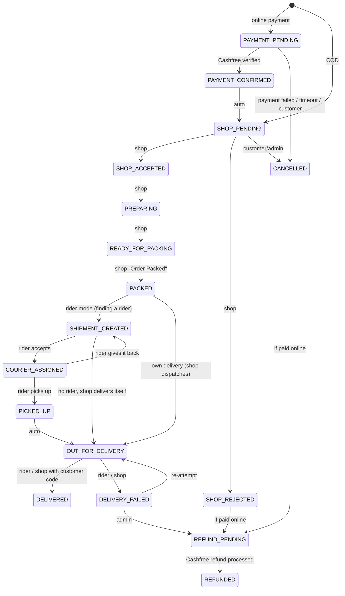
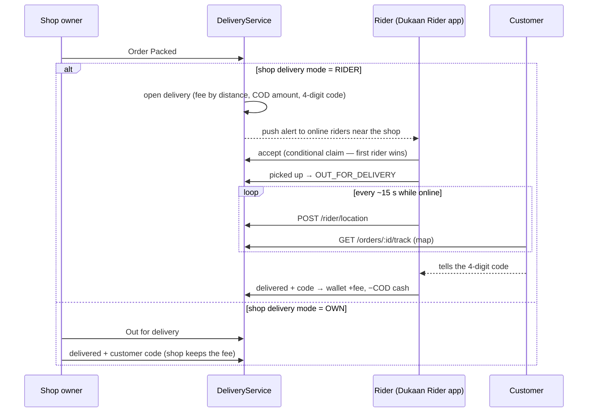

# Dukaan Express — System Architecture

Multi-vendor instant-delivery marketplace. One Next.js 16 application hosts four
interfaces (Customer, Shop Owner, Super Admin, Delivery/Shipment management) over a
single modular backend and one PostgreSQL database.

## 1. High-level architecture

```mermaid
flowchart LR
  subgraph Clients
    C[Customer app<br/>/ (mobile-first)]
    S[Shop Owner app<br/>/shop (mobile-first)]
    A[Super Admin dashboard<br/>/admin]
  end

  subgraph NextJS["Next.js 16 (Vercel / Node)"]
    P[proxy.ts<br/>route guard by role]
    API["REST API /api/v1/*<br/>route handlers"]
    MW["apiHandler()<br/>auth · RBAC · zod validation<br/>rate limit · error mapping"]
    subgraph Services["Domain services (src/server/services)"]
      AUTH[auth / otp]
      CAT[catalog / inventory]
      CART[cart / pricing]
      ORD[order state machine]
      PAY[payments]
      SHIP[shipment orchestrator]
      COM[commission / settlement]
      NOTIF[notifications]
      REP[reports]
      SET[settings]
    end
    subgraph Adapters["Integration adapters (src/server/integrations)"]
      LF[Leaflet + OSM tiles<br/>customer live map]
      RZ[Cashfree<br/>live | mock]
      GM[Maps<br/>OSM Nominatim · ORS / Google · haversine]
      FCM[Firebase FCM<br/>live | log]
      SMS[SMS OTP<br/>live | console]
      ST[Storage<br/>Cloudinary | local disk]
    end
    RT[SSE /api/v1/realtime<br/>event bus]
  end

  DB[(PostgreSQL<br/>Prisma 7)]
  EXT2[(Cashfree PG API)]
  EXT3[(OpenStreetMap / ORS)]
  EXT4[(FCM)]

  C & S & A --> P --> API --> MW --> Services
  Services --> DB
  Services --> Adapters
  SR --> EXT1
  RZ --> EXT2
  GM --> EXT3
  FCM --> EXT4
  EXT1 -- webhook --> API
  EXT2 -- webhook --> API
  NOTIF --> RT --> C & S & A
```

### Key design decisions

| Concern | Decision |
|---|---|
| Hosting | Single Next.js app (Vercel). API routes are thin; all logic lives in `src/server/services` so it can be extracted to a standalone Node service later without rewrites. |
| Auth | Stateless JWT (HS256 via `jose`) in an `httpOnly`, `SameSite=Lax` cookie; `sessionVersion` on the user lets admins revoke all sessions (password reset / deactivate). Everyone logs in with a bcrypt password: staff by email, customers by email or mobile number. Customers verify their email with a 6-digit code at signup (hashed, 10-minute TTL, single-use, attempt-limited); the signup call needs a 30-minute signed proof of that verification (separate JWT issuer, never valid as a session). Forgotten passwords are reset by an emailed code. SMS OTP login is currently disabled. |
| RBAC | Roles `SUPER_ADMIN`, `SHOP_OWNER`, `CUSTOMER`. Enforced in **three** places: `proxy.ts` (page routing), `apiHandler({ roles })` (API), and services (ownership scoping — a shop owner query always filters by their `shopId`). |
| Catalog model | `Product` (global master: name, category, images, attributes) is independent of `ShopInventory` (shop-specific price, MRP, stock, availability). The same product is sold by many shops at different prices. Variants are `ProductVariant`; inventory rows are per (shop, product, variant). |
| Money | All amounts stored as integer **paise** (`Int`) — no floating point. Totals, discounts, taxes, delivery fees and commission are always computed server-side; client-submitted prices are ignored. |
| Order state | Explicit state machine (`src/server/services/order-state.ts`) with an allow-list of transitions **and** the role allowed to perform each. Every transition writes `OrderStatusHistory` inside the same DB transaction. Optimistic concurrency: updates use `where: { id, status: from }`. |
| Stock | Reserved atomically at order placement with conditional `UPDATE … WHERE stock >= qty`; released on rejection / cancellation / payment failure. |
| Multi-shop future | Cart lines carry `shopId`; `Order` has `checkoutGroupId` so one checkout can later fan out into one order per shop. v1 enforces single-shop carts in the cart service. |
| Delivery | No third-party courier. `Shipment` is the delivery record (one per order, `mode` OWN or RIDER). Rider jobs are claimed with a conditional update (`riderId IS NULL AND status = CREATED`), so exactly one rider wins. Delivery completes only with the customer's 4-digit handover code. Rider earnings and COD cash are a ledger (`RiderWalletEntry`, unique per order and type); withdrawals set money aside immediately and return it if declined. |
| Payments | Cashfree order (`/pg/orders`, API 2025-01-01) created server-side when checkout opens; the browser gets only a `payment_session_id` and opens the Cashfree JS SDK modal. Success is never taken from the browser: the server re-reads the order and its payments from Cashfree (amount must match). Webhooks (`PAYMENT_SUCCESS_WEBHOOK`, `PAYMENT_FAILED_WEBHOOK`, `REFUND_STATUS_WEBHOOK`) are verified with `x-webhook-signature` = base64 HMAC-SHA256(timestamp + raw body, secret key). All webhooks are stored in `WebhookEvent` with a unique `(provider, eventId)` for de-duplication. |
| Real-time | Notifications persisted in DB, pushed over Server-Sent Events from an in-process event bus (with DB polling fallback, so it works across serverless instances), plus FCM push when configured. |
| Mock adapters | When credentials are absent, each integration resolves to an isolated mock adapter (`*.mock.ts`) and the UI shows a "SANDBOX" badge. Mocks never pretend to be the real provider: their ids are prefixed `MOCK-`. |

## 2. Order lifecycle



Customer-visible timeline groups these into: Order Placed → Payment Confirmed → Shop
Accepted → Preparing → Ready for Packing → Packed → Rider Assigned →
Picked Up → Out for Delivery → Delivered.

## 3. Delivery workflow



## 4. Folder structure

```
.
├── docs/                      architecture, ER diagram, API, deployment
├── prisma/
│   ├── schema.prisma          normalized schema (≈35 models)
│   ├── migrations/            SQL migrations
│   └── seed.ts                realistic seed data (Bengaluru shops, products)
├── prisma.config.ts
├── public/uploads/            local storage adapter target (dev only)
├── src/
│   ├── proxy.ts               role-based page routing (Next 16 "proxy")
│   ├── app/
│   │   ├── (customer)/        customer app: home, search, product, shop, cart, checkout, orders, account
│   │   ├── login/             customer login; /login/staff for admin & shop owner; /signup, /forgot-password
│   │   ├── shop/              shop owner app (mobile-first)
│   │   ├── admin/             super admin dashboard
│   │   ├── api-docs/          Swagger UI
│   │   └── api/v1/            REST API (auth, admin, shop, catalog, cart, orders, payments, webhooks, reports, settings, realtime)
│   ├── components/
│   │   ├── ui/                design-system primitives (shadcn/ui style)
│   │   ├── customer/ shop/ admin/ shared/
│   ├── lib/                   client-safe utils (money, format, api client, status labels)
│   └── server/
│       ├── db.ts  env.ts  errors.ts  http.ts (apiHandler)  rate-limit.ts
│       ├── auth/              jwt, session, password, otp
│       ├── services/          domain logic (one file per bounded context)
│       ├── integrations/      cashfree/ maps/ fcm/ sms/ storage/ email (live + mock)
│       ├── realtime/          event bus
│       └── openapi.ts         OpenAPI 3.1 document
└── tests/                     vitest unit + integration tests
```

## 5. Development plan (phases)

| Phase | Scope | Status |
|---|---|---|
| 1 | Setup, architecture, schema, auth, RBAC | ✅ |
| 2 | Admin dashboard, shop onboarding, owners, categories | ✅ |
| 3 | Shop owner app, inventory management | ✅ |
| 4 | Customer app, location-based browsing | ✅ |
| 5 | Cart, checkout, Cashfree, order creation | ✅ |
| 6 | Accept / prepare / pack workflow | ✅ |
| 7 | Deliveries: own staff + Dukaan Express riders, live tracking, rider wallet | ✅ |
| 8 | Notifications, SSE real-time, FCM | ✅ |
| 9 | Reports, commissions, settlements, refunds, settings | ✅ |
| 10 | Tests, security hardening, deployment docs | ✅ |
