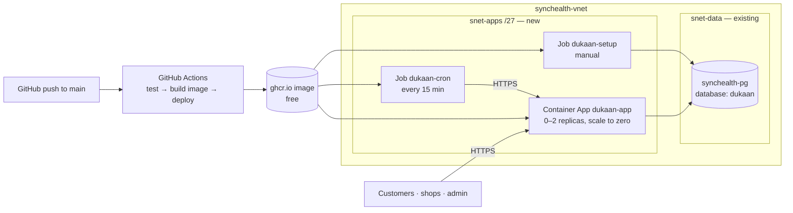

# Deploying to Azure (free-tier friendly)

Target: **Azure Container Apps (Consumption)** inside the same VNet as the existing private PostgreSQL Flexible Server `synchealth-pg` (Private access / VNet integration on `synchealth-vnet`).



## What it costs

| Resource | Cost |
|---|---|
| Container Apps environment (workload-profiles, Consumption only) | No environment charge |
| App + jobs | Covered by the monthly free grant (180k vCPU-s, 360k GiB-s, 2M requests per subscription) at low traffic. Each cron run wakes the app, which then idles ~5 min before scaling to zero — set the cron to 30 min if you want to minimise usage. |
| Container registry | GitHub Container Registry — free |
| Logs | Disabled below (`--logs-destination none`); live log streaming still works |
| Database | Existing server; one more database on it costs nothing extra |
| Outbound internet (Razorpay/Shiprocket APIs) | Default outbound — no NAT gateway needed |

**Set a budget alert**: Portal → Cost Management → Budgets → *Add* → ₹100/month with an email alert at 50%. You'll know immediately if anything starts costing money.

## 0. Prerequisites

- Use **Azure Cloud Shell → Bash** (portal toolbar `>_`; choose *No storage account required*). All commands below are bash.
- The code is pushed to GitHub so the workflow has built the first image (the deploy step is skipped until step 7). Find the image tag under the repo's **Packages**, or the `build` job log: `ghcr.io/muralibedetanapalli-lab/dukaan-express:<commit-sha>`.
- Make the package **public** (GitHub → your profile → Packages → dukaan-express → Package settings → Change visibility → Public). The image contains no secrets; all secrets are injected at runtime. *(If you keep it private, see "Private image" at the end.)*

```bash
RG="<resource group of synchealth-pg>"
LOC="<same region as the VNet, e.g. centralindia>"
VNET=synchealth-vnet
PG=synchealth-pg
CAE=dukaan-env
APP=dukaan-app
IMAGE="ghcr.io/muralibedetanapalli-lab/dukaan-express:<commit-sha>"

az extension add --name containerapp --upgrade
az provider register -n Microsoft.App --wait
```

## 1. Create the database

```bash
az postgres flexible-server db create -g $RG -s $PG -d dukaan
```

Note the server's admin user name (Portal → `synchealth-pg` → Overview → *Server admin login name*). Its host name is `synchealth-pg.postgres.database.azure.com`; inside the VNet it resolves to the private IP through the private DNS zone created with the server.

## 2. Add a subnet for the apps

Find a free /27 range in the VNet:

```bash
az network vnet show -g $RG -n $VNET --query "addressSpace.addressPrefixes" -o tsv
az network vnet subnet list -g $RG --vnet-name $VNET --query "[].{name:name, prefix:addressPrefix}" -o table
```

Pick an unused /27 inside the address space (example below uses `10.0.2.0/27` — **change it** to fit yours):

```bash
az network vnet subnet create -g $RG --vnet-name $VNET -n snet-apps \
  --address-prefixes 10.0.2.0/27 --delegations Microsoft.App/environments
SUBNET_ID=$(az network vnet subnet show -g $RG --vnet-name $VNET -n snet-apps --query id -o tsv)
```

## 3. Create the Container Apps environment (in the VNet)

```bash
az containerapp env create -g $RG -n $CAE -l $LOC \
  --infrastructure-subnet-resource-id "$SUBNET_ID" \
  --enable-workload-profiles \
  --logs-destination none
```

## 4. Create the app

Secrets are typed at a hidden prompt so they never land in shell history or this chat:

```bash
read -p  "DB admin user: " PGUSER
read -sp "DB password: " PGPASS; echo
# URL-encode the password in case it has @ # : / characters
PGPASS_ENC=$(python3 -c 'import urllib.parse,sys; print(urllib.parse.quote(sys.argv[1], safe=""))' "$PGPASS")
DBURL="postgresql://${PGUSER}:${PGPASS_ENC}@${PG}.postgres.database.azure.com:5432/dukaan?sslmode=verify-full"
JWT=$(openssl rand -base64 48 | tr -d '\n')
CRON=$(openssl rand -hex 24)

az containerapp create -g $RG -n $APP --environment $CAE --workload-profile-name Consumption \
  --image "$IMAGE" --ingress external --target-port 3000 \
  --min-replicas 0 --max-replicas 2 --cpu 0.5 --memory 1.0Gi \
  --secrets database-url="$DBURL" jwt-secret="$JWT" cron-secret="$CRON" \
  --env-vars DATABASE_URL=secretref:database-url JWT_SECRET=secretref:jwt-secret CRON_SECRET=secretref:cron-secret \
             DB_POOL_MAX=5 RUN_MIGRATIONS=true

FQDN=$(az containerapp show -g $RG -n $APP --query properties.configuration.ingress.fqdn -o tsv)
az containerapp update -g $RG -n $APP --set-env-vars APP_URL="https://$FQDN" -o none
echo "App URL: https://$FQDN"
curl -s "https://$FQDN/api/v1/health"
```

The first start applies the database migrations automatically. `health` should return `"status":"ok"`. If not: `az containerapp logs show -g $RG -n $APP --follow`.

## 5. One-time setup: categories + your admin account

```bash
read -p  "Admin email: " ADMIN_EMAIL
read -sp "Admin password (10+ chars, letters and numbers): " ADMIN_PASS; echo

az containerapp job create -g $RG -n dukaan-setup --environment $CAE --workload-profile-name Consumption \
  --trigger-type Manual --replica-timeout 600 --replica-retry-limit 0 \
  --image "$IMAGE" --cpu 0.5 --memory 1.0Gi \
  --secrets database-url="$DBURL" admin-password="$ADMIN_PASS" \
  --env-vars DATABASE_URL=secretref:database-url ADMIN_EMAIL="$ADMIN_EMAIL" ADMIN_PASSWORD=secretref:admin-password \
  --command "node" --args "scripts/setup.mjs"

az containerapp job start -g $RG -n dukaan-setup
# check the result (Succeeded / Failed)
az containerapp job execution list -g $RG -n dukaan-setup --query "[0].properties.status" -o tsv
```

Then log in at `https://<FQDN>/login/staff`. Re-running the job is safe; to reset a forgotten admin password, add `ADMIN_RESET_PASSWORD=true` to the job's env vars and start it again. You can then **delete the admin password secret** from the job (Portal → job → Secrets).

The setup creates roles and the default categories only. Add your service areas/localities in **Admin → Settings → Service areas** and onboard shops from **Admin → Shops** (do *not* run the demo seed on this database — it wipes all tables).

## 6. Maintenance job (expires unpaid orders, auto-rejects ignored orders, reconciles shipments)

```bash
az containerapp job create -g $RG -n dukaan-cron --environment $CAE --workload-profile-name Consumption \
  --trigger-type Schedule --cron-expression "*/15 * * * *" --replica-timeout 120 --replica-retry-limit 1 \
  --image "$IMAGE" --cpu 0.25 --memory 0.5Gi \
  --secrets cron-secret="$CRON" \
  --env-vars APP_URL="https://$FQDN" CRON_SECRET=secretref:cron-secret \
  --command "node" --args "scripts/cron.mjs"
```

## 7. Automatic deploys from GitHub (OIDC — no stored Azure passwords)

```bash
APPID=$(az ad app create --display-name dukaan-github-deploy --query appId -o tsv)
az ad sp create --id $APPID -o none
az ad app federated-credential create --id $APPID --parameters '{
  "name": "github-production",
  "issuer": "https://token.actions.githubusercontent.com",
  "subject": "repo:muralibedetanapalli-lab/Dukaan-Express:environment:production",
  "audiences": ["api://AzureADTokenExchange"]
}'
# GitHub may present an ID-based subject instead (repo:<owner>@<ownerId>/<repo>@<repoId>:environment:production).
# If azure/login fails with AADSTS700213, add a second credential with the exact subject from the error message.
# Least privilege: the deploy identity can only update these three resources (not the database).
for r in $(az containerapp show -g $RG -n $APP --query id -o tsv) \
         $(az containerapp job show -g $RG -n dukaan-setup --query id -o tsv) \
         $(az containerapp job show -g $RG -n dukaan-cron --query id -o tsv); do
  az role assignment create --assignee $APPID --role Contributor --scope "$r" -o none
done
echo "AZURE_CLIENT_ID=$APPID"
echo "AZURE_TENANT_ID=$(az account show --query tenantId -o tsv)"
echo "AZURE_SUBSCRIPTION_ID=$(az account show --query id -o tsv)"
```

In GitHub → repo → **Settings**:
1. **Environments** → *New environment* → `production`.
2. **Secrets and variables → Actions → Secrets**: `AZURE_CLIENT_ID`, `AZURE_TENANT_ID`, `AZURE_SUBSCRIPTION_ID` (values printed above — these are identifiers, not passwords).
3. **Variables**: `AZURE_RESOURCE_GROUP` = your RG, `AZURE_CONTAINERAPP` = `dukaan-app`, `AZURE_CONTAINERAPP_JOBS` = `dukaan-setup dukaan-cron`.

From now on every push to `main` runs tests, builds the image and rolls it out to the app and both jobs.

## 8. Turning on integrations (when you're ready)

Add each as a secret + env var, e.g. Razorpay **test** keys (free):

```bash
az containerapp secret set -g $RG -n $APP --secrets rzp-key-secret="<secret>" rzp-webhook-secret="<secret>"
az containerapp update -g $RG -n $APP --set-env-vars RAZORPAY_KEY_ID="rzp_test_xxx" \
  RAZORPAY_KEY_SECRET=secretref:rzp-key-secret RAZORPAY_WEBHOOK_SECRET=secretref:rzp-webhook-secret
```

Same pattern for `CLOUDINARY_*` (needed for image uploads in production), `SHIPROCKET_*`, `GOOGLE_MAPS_API_KEY`, `FCM_*`, `SMS_*` — see [DEPLOYMENT.md](DEPLOYMENT.md) for where to get each value and the webhook URLs (`https://<FQDN>/api/v1/webhooks/...`).

**Customer login needs SMS.** Until an SMS provider is configured, production does not show OTPs. For a *private pilot only*, `OTP_SANDBOX_IN_PRODUCTION=true` shows the OTP on screen — anyone could then log in as any number, so never leave it on publicly.

## Custom domain (optional, free)

Container Apps provides a free managed certificate: Portal → `dukaan-app` → Custom domains → Add → follow the DNS (CNAME + TXT) steps. Then update `APP_URL` to the new domain.

## Private image (if you keep the GHCR package private)

Create a GitHub classic PAT with only `read:packages`, then:

```bash
az containerapp registry set -g $RG -n $APP --server ghcr.io --username <github-username> --password <PAT>
# and add the same --registry-server/--registry-username/--registry-password to both job create commands
```

## Troubleshooting

| Symptom | Fix |
|---|---|
| `health` times out / `P1001 Can't reach database` | Environment not in `synchealth-vnet`, or the server's private DNS zone isn't linked to the VNet (Portal → Private DNS zones → `*.private.postgres.database.azure.com` → Virtual network links). |
| `password authentication failed` | Wrong user/password, or special characters not URL-encoded. Update with `az containerapp secret set ... database-url=...` then `az containerapp revision restart`. |
| `too many connections` | Lower `DB_POOL_MAX` (the server is shared with SyncHealth). |
| Image uploads fail in production | Configure `CLOUDINARY_*` (container disks are wiped on restart). |
| First request slow | Scale-to-zero cold start (~5–15 s). Set `--min-replicas 1` if you need it always warm (no longer free). |
