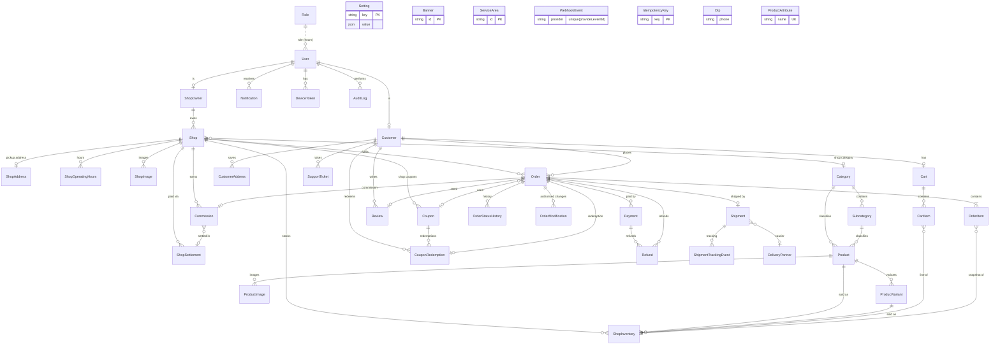

# Database design & ER diagram

PostgreSQL via Prisma 7 (`prisma/schema.prisma`, migrations in `prisma/migrations`).

**Conventions**
- Primary keys are `cuid()` strings; all money is integer **paise**; rates are **basis points** (1% = 100).
- `createdAt` / `updatedAt` on every mutable table; soft delete (`deletedAt`) on `User`, `Shop`, `Category`, `Product`, `ShopInventory`, `CustomerAddress`.
- Every status change of an order is written to `OrderStatusHistory` in the same transaction.
- Webhooks are de-duplicated by the unique key `(provider, eventId)`; shipments by unique `orderId`, `channelOrderId` and `awbCode`.

## Entity relationship diagram

## Key tables

| Table | Purpose / notable constraints |
|---|---|
| `User` | One row per login. `role` ∈ SUPER_ADMIN, SHOP_OWNER, CUSTOMER. Unique `email`, `phone`. `sessionVersion` revokes JWTs. |
| `Role` | Reference table of roles and their permission descriptors. |
| `Customer`, `ShopOwner` | Role profiles (1:1 with `User`). |
| `Shop` | Approval (`approvalStatus`) is separate from operational state (`isActive`, `acceptingOrders`). `commissionBps` null → platform default. `pickupLocationName` = nickname registered with Shiprocket. |
| `Product` | **Global master** (name, category, dimensions, images). Independent of any shop. |
| `ShopInventory` | **Shop-specific** price/MRP/stock/availability. Unique `(shopId, productId, variantKey)` — `variantKey` makes the key NULL-safe. |
| `Cart` / `CartItem` | Lines carry `shopId` so a future checkout can split into per-shop orders. |
| `Order` | Immutable price snapshot (subtotal, discounts, fees, tax, commission). `checkoutGroupId` groups sibling orders from one checkout (multi-shop ready). |
| `OrderItem` | Snapshot of product name, unit price, tax at purchase time. |
| `OrderStatusHistory` | from → to, actor id + role, remarks, timestamp. |
| `OrderModification` | Shop-requested reductions that require admin approval. |
| `Payment` / `Refund` | Razorpay ids unique; refund statuses PENDING → PROCESSING → PROCESSED/FAILED. |
| `Shipment` | One per order; `channelOrderId` is the idempotency key sent to Shiprocket. Stores Shiprocket order/shipment ids, AWB, courier, label, pickup, attempts, last error. |
| `ShipmentTrackingEvent` | Raw + mapped status, location, source (WEBHOOK/POLL/SYSTEM). |
| `Commission` / `ShopSettlement` | Commission recorded on delivery; settlements bundle unsettled commissions per period. |
| `Setting` | JSON per settings group, validated by zod on read and write. |
| `AuditLog` | Every admin/shop mutation and order transition. |
| `WebhookEvent` | Raw inbound webhooks with signature validity and processing result. |
| `IdempotencyKey` | Order-placement idempotency (per user + key). |

## Indexes

Hot paths are indexed: `Order(shopId,status)`, `Order(customerId,createdAt)`, `Order(status,createdAt)`, `ShopInventory(shopId,isAvailable)`, `ShopInventory(productId)`, `ShopAddress(latitude,longitude)`, `Notification(userId,readAt)`, `ShipmentTrackingEvent(shipmentId,occurredAt)`, `AuditLog(entityType,entityId)`.
